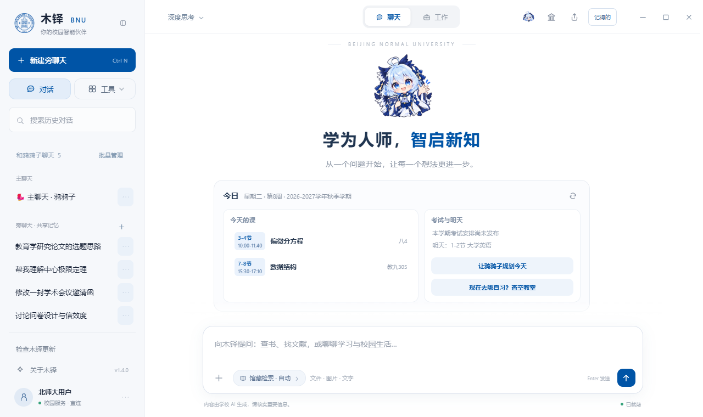
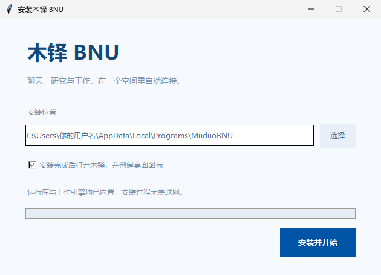

<div align="center">

# 木铎 BNU

北师大同学自制的校园桌面助手 · Windows 版

## [⬇ 点这里下载木铎 BNU（最新版）](https://github.com/Oneline2436/muduo_AI-bnu-releases/releases/latest/download/MuduoBNU-Setup.exe)

<a href="https://github.com/Oneline2436/muduo_AI-bnu-releases/releases/latest/download/MuduoBNU-Setup.exe"></a>

文件名 `MuduoBNU-Setup.exe`，始终是最新版，下载后双击安装。

<!-- MIRROR: 师大云盘镜像链接确认后取消这一行的注释
**[校内更快：师大云盘镜像](填入分享链接)** · 提取码 填入
-->

GitHub 下载慢时，可以换个时间或换个网络再试。



</div>

---

## 三步装好

### 1. 下载
点上面蓝色按钮，浏览器会下载 `MuduoBNU-Setup.exe`。
如果浏览器提示「此文件通常不会被下载」，点 **…** → **保留**。

### 2. 运行安装程序
双击下载好的文件。因为木铎还没有做 Windows 代码签名，第一次可能看到蓝色的 **「Windows 已保护你的电脑」**：

1. 点 **更多信息**；
2. 确认发布者一栏写的是「未知发布者」、文件名是 `MuduoBNU-Setup.exe`；
3. 点 **仍要运行**。

然后会看到下面的安装窗口，安装位置不用改，直接点 **安装并开始**，等进度条走完（约 1～3 分钟，全程不需要联网）。



### 3. 登录
桌面上会出现「木铎 BNU」图标。打开后用**学校统一身份认证账号**（和数字京师相同）登录即可。

> 以后有新版本时，木铎会在右下角提示更新：点确认就会自动下载、校验签名、安装并重启；不点就不会动。

---

## 常见问题

**电脑要求？** Windows 10 或 11（64 位），硬盘留 2 GB 左右空间。暂时没有 Mac 版。

**安全吗？账号会不会被上传？**
学校账号和个人数据只用 Windows 自带的加密（DPAPI）保存在你自己的电脑上，不会上传到任何第三方服务器。木铎访问学校系统时只读取、不修改；预约、发邮件、提交这类操作都会先弹确认卡，你点了才会执行。

**怎么确认下载的文件没被改过？**
在下载目录打开 PowerShell，运行：
```powershell
Get-FileHash .\MuduoBNU-Setup.exe -Algorithm SHA256
```
当前版本 1.4.1 的结果应为 `AB37DD7F9DC32790F1DEE5FEA8137191222C883B79AEB6CD77CB8D605B5ED92A`。以后每个版本的校验值，在[发布页](https://github.com/Oneline2436/muduo_AI-bnu-releases/releases/latest)每个文件旁的 sha256 里都能看到。

**下面那些 `.zip`、`muduo-update.json`、`.sig` 是什么？** 给自动更新用的，不需要手动下载。

**怎么卸载？** 先从右下角托盘退出木铎，再到 Windows「设置 → 应用 → 已安装的应用」找到「木铎 BNU」点卸载。卸载会保留聊天记录等个人数据（在 `%LOCALAPPDATA%\BNUDesktop`），想彻底清除就把这个文件夹也删掉。

---

## 说明

- 木铎是北师大同学自制的**非官方**客户端，不是学校信息网络中心的产品，与学校没有隶属关系。
- 木铎只做**只读**访问，并且自带限流。请不要用它或照着它的流程去高频、批量访问学校系统；遇到验证码、访问受限，请按学校页面的提示处理。
- 本仓库只放安装包，不含源码。问题和建议请联系作者。

[查看全部版本与更新说明 →](https://github.com/Oneline2436/muduo_AI-bnu-releases/releases)
